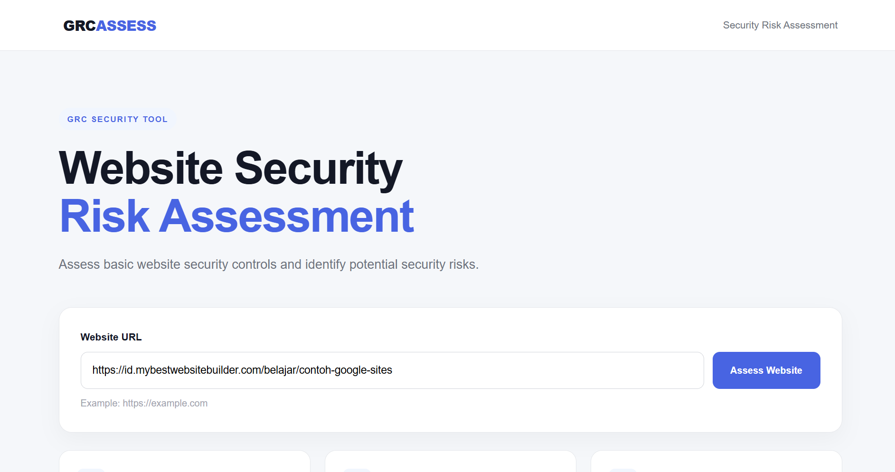
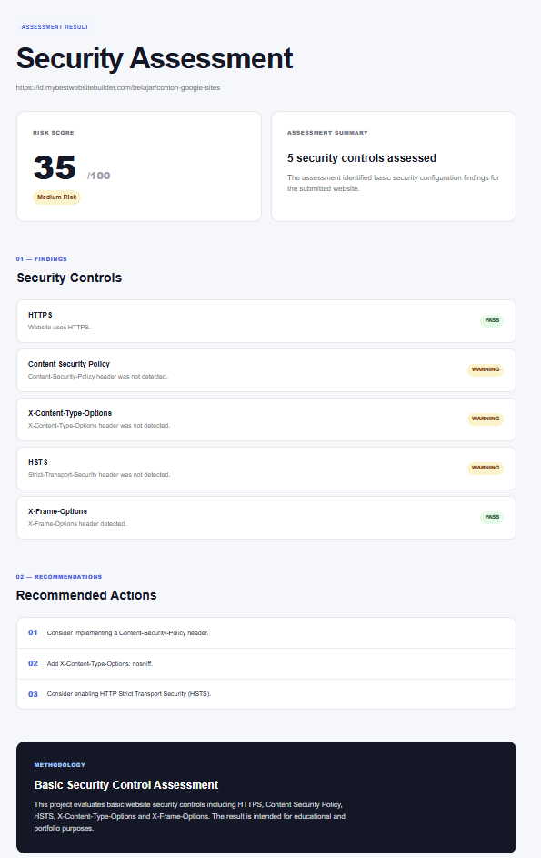
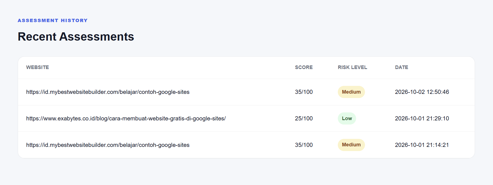

# GRCASSESS - Website Security Risk Assessment Tool

**GRCASSESS** is a web-based Governance, Risk, and Compliance (GRC) security assessment tool designed to evaluate basic website security controls and identify potential security risks.

The tool allows users to **enter a website URL and automatically perform a security assessment**. GRCASSESS analyzes the target website's basic security configuration, calculates a risk score, identifies security findings, and provides recommendations to improve the website's security posture.

## 📌 Project Overview

GRCASSESS was developed as a portfolio project to demonstrate the application of **GRC and cybersecurity risk assessment concepts** in a practical web-based tool.

Instead of manually reviewing a website's basic security configuration, users can simply submit a website URL and let the application perform the assessment automatically.

### Assessment Flow

```text
Enter Website URL
        ↓
Website Security Scan
        ↓
Security Control Analysis
        ↓
Risk Score Calculation
        ↓
Security Findings
        ↓
Risk Level
        ↓
Recommendations
```

## 🔍 Key Features

### 1. Website URL Assessment

Users can enter a website URL, and GRCASSESS automatically performs a basic security assessment of the target website.

### 2. Security Control Analysis

The assessment checks several fundamental website security controls, including:

- HTTPS
- Content-Security-Policy (CSP)
- HTTP Strict Transport Security (HSTS)
- X-Content-Type-Options
- X-Frame-Options

These controls are evaluated based on the HTTP response and security headers returned by the target website.

### 3. Risk Score

GRCASSESS calculates a risk score based on the security findings identified during the assessment.

The score is presented on a **0–100 scale** and is used to determine the overall risk level.

### 4. Risk Classification

The assessment categorizes the result into:

- **Low Risk**
- **Medium Risk**
- **High Risk**

This provides a simple way to understand the overall security posture of the assessed website.

### 5. Security Findings

The result page provides detailed findings for each assessed security control, including whether a control:

- **PASS** — The security control was detected.
- **WARNING** — The security control was not detected and may require attention.
- **FAIL** — A significant security configuration issue was identified.

### 6. Security Recommendations

For identified issues, GRCASSESS provides recommendations that can help improve the website's security configuration.

For example, the tool may recommend:

- Enabling HTTPS
- Implementing a Content Security Policy
- Enabling HSTS
- Adding `X-Content-Type-Options: nosniff`
- Implementing `X-Frame-Options` or an equivalent CSP policy

### 7. Assessment History

Previous assessments are stored and displayed in the application, allowing users to review recently assessed websites, their risk scores, risk levels, and assessment dates.

## 🖥️ Screenshots

### Website Assessment

Users can enter the target website URL and start the security assessment



### Assessment Result

After the scan is completed, GRCASSESS displays the risk score, risk level, security findings, and recommended actions.



### Assessment History

The application also provides a history of recently performed assessments.



## 🛠️ Technologies

- **PHP** — Backend and assessment logic
- **MySQL** — Assessment data storage
- **HTML5** — Application structure
- **CSS3** — User interface and styling
- **cURL** — Website HTTP request and security header analysis

## 🧩 How It Works

When a user submits a website URL, GRCASSESS performs an HTTP request to the target website and retrieves its response headers.

The application then analyzes the available security controls and generates findings based on the detected configuration.

The findings are converted into a risk score, which is then classified into a risk level. Finally, the application presents the assessment results together with recommendations for improving the website's security posture.

## 🎯 GRC Perspective

GRCASSESS demonstrates a simplified implementation of a **security risk assessment process**:

| GRC Process | GRCASSESS Implementation |
|---|---|
| Identify Asset | Website URL submitted by the user |
| Assess Controls | Security headers and HTTPS configuration |
| Identify Findings | Missing or detected security controls |
| Risk Analysis | Risk score calculation |
| Risk Classification | Low, Medium, or High |
| Risk Treatment | Security recommendations |
| Documentation | Assessment history |

## ⚠️ Scope & Disclaimer

GRCASSESS is designed for **educational and portfolio purposes**.

The tool performs a **basic security configuration assessment** and does not replace a professional penetration test, vulnerability assessment, security audit, or comprehensive application security assessment.

The assessment focuses on externally observable website security configurations and should not be interpreted as a complete representation of a website's overall security posture.

Only assess websites that you own or have explicit authorization to assess.

## 👩‍💻 Author

**Auleen Katarina**

Cyber Security Student  
BINUS University

---

⭐ If you find this project useful, feel free to explore the repository and provide feedback.